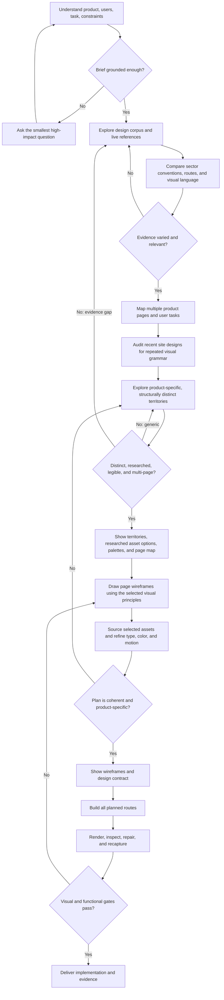

# Web design expedition

This workflow is the design authority for the task. Do not delegate the design to another design skill, template generator, UI kit, or preset component system. Reuse existing product components only after checking that they serve the chosen direction. Do not let familiar SaaS patterns silently decide the result.

The finished website is always a Next.js application. Extend an existing Next.js project in place; for a new or non-Next.js site, create or migrate to Next.js, normally with the App Router and TypeScript. Build page routes and shared structure with React components. A static HTML/CSS or SVG wireframe is allowed as a temporary visual artifact only; it must not become the delivered website. Follow the project’s package manager, scripts, and conventions when they exist.

This is a visible, evidence-led workflow for creating or substantially redesigning a website or app. Its job is to help an agent understand the product, learn the design landscape, find a distinct point of view, show the proposed experience, and then build and inspect it. It is a flexible path with checkpoints, not a fixed recipe for what every interface should look like.

Show the user useful visual work as it becomes available: reference boards, pattern maps, design territories, wireframes, and rendered pages. Default to sharing a preview and continuing when the user has asked for autonomous execution. Pause for a choice when they are exploring, when a direction choice materially changes the product, or when proceeding would exceed the request. A preview is useful even when no decision is needed.

## Flow at a glance

Use the loops when they add information. Do not research forever: continue until the evidence is sufficient to distinguish common expectations from real opportunities, record thin or mismatched evidence, and move forward with honest uncertainty. For substantial work, also read [the anti-repeat design check](anti-repeat-design.md): a territory can be novel relative to competitors yet still repeat the agent’s own recent output.

## 1. Find the product's soul

Inspect the existing product, route, copy, functionality, repository, and supplied materials. For a greenfield product, use the brief and ask only what cannot be inferred. Capture the current interface when one exists and browser access is available.

Write a short product brief:

- who the experience serves and what they are trying to do;
- the moment or context they arrive in;
- product promise, distinctive capabilities, proof, and constraints;
- existing identity or design system to preserve;
- what currently feels weak, confusing, generic, or missing;
- the intended emotional register, grounded in the product and audience.

Look for the product's human stakes and specific character. Do not manufacture a brand personality from adjectives. Ask one bundled, concise question only when a missing answer could change the main flow, audience, or hard brand constraint. Otherwise state a reasonable assumption and proceed.

**Checkpoint:** each important user need and product claim has a source in the product, brief, or an explicitly labeled assumption.

## 2. Explore the design landscape

Start with same-sector and same-product research. Inspect at least three direct products when the market has them; compare their homepages and relevant product, pricing, about, documentation, and use-case pages. First record how those products structure routes and sections, guide key tasks, place proof and calls to action, and handle responsive behavior. If fewer than three credible direct references exist, inspect what is available and say so. Once the sector expectations are clear, expand in two directions so competitors inform the work without owning it:

1. **Adjacent references:** products with a similar task, information shape, or interaction.
2. **Unexpected visual references:** work from other fields that may offer a useful composition, image treatment, typographic direction, palette, or motion idea.

Use a design screenshot/reference corpus when available, including Lazyweb if its MCP tools are connected. Search it broadly by screen type, component, product category, interaction, and visual treatment. Read [the inspiration corpus](inspiration-corpus.md) when selecting public galleries and UX libraries: it records what each source is good for, examples already inspected, access limits, and risks. Choose references by the question at hand; do not browse every listed site by rote.

Broaden research beyond the product sector so direct competitors do not dictate the visual direction. Select sources from three useful groups:

1. **Visual direction and composition:** galleries such as Godly/Recent, SiteInspire, Awwwards, Land-book, Minimal Gallery, and Brutalist Websites help find typography, image treatment, page rhythm, section composition, motion, and uncommon visual territories.
2. **Product UI patterns:** Refero and Mobbin organize real product screens around page types, components, and patterns such as pricing, dashboards, navigation, search, onboarding, and settings.
3. **End-to-end task flows:** Page Flows and public flow collections help inspect the steps, states, and feedback in tasks such as setup, booking, checkout, upload, or account changes.

Start with the same-sector and same-product references as required, then pick at least one cross-sector visual reference and one interaction/flow reference when they materially help answer the design brief. A single source can serve both roles if its evidence fits. When building a primarily marketing site with no complex app task, a visual reference may be enough; do not invent an interaction research requirement. If login or payment gates the relevant example, do not create an account or pay merely to complete the survey; record the limit and use a public example from another source.

After the sector pattern map, use the selected visual references to investigate concrete opportunities for this product: image subjects and treatments, motion behavior, typography roles and hierarchy, color relationships, and page composition. Record what to adopt as a principle, what to adapt, what to reject, and the product evidence for each decision. Research candidate asset sources and licenses before locking an image direction; test palette choices beside the actual candidate imagery.

For each selected reference, inspect the actual page, section, or flow rather than relying on its thumbnail or tag alone. Record the URL, source type, page/section/task, viewport and capture date where available, direct observations, user purpose, candidate principle, product-specific adaptation, and risk. Look beyond the hero: note section sequence, typography hierarchy, image role and crop, proof placement, navigation behavior, CTA context, responsive treatment, and relevant states. Keep same-sector findings about common UX and information architecture distinct from cross-sector visual inspiration. For every principle selected from either set, record where it will be applied in this product and why it fits; do not just collect screenshots or make a moodboard. Distinguish first-hand rendered observations from tags, search-result descriptions, screenshots, and interpretation. Extract principles; do not copy branding, text, assets, or distinctive compositions.

Use the connected corpus and live web research together when they answer different questions. A corpus is a starting library that can grow through new captures, not a claim that the internet has been exhaustively searched. Keep the selected set useful and varied rather than maximizing count. If a source cannot be inspected, label it as a search result or secondary description rather than firsthand visual evidence.

Show a reference board or visual evidence strip when captures are available. Group references by the question they answer, not as an undifferentiated inspiration collage.

## 3. Map convention and open space

Compare references using a matrix of meaningful sections and behaviors. Examples include navigation, first-use explanation, proof, search/filtering, workflow steps, empty states, pricing, onboarding, or support; choose categories that fit this product.

For each pattern, note:

- how many inspected references contain it and the denominator;
- which references use it, and in what form;
- what user need it appears to serve;
- what is different, absent, or contradicted;
- evidence limits, such as inaccessible screens or an unbalanced sample.

Counts describe this sample; they do not establish a universal rule. An absence can be intentional or simply outside the captured page. Distinguish observed facts from interpretation. Identify expected conventions worth retaining, stale patterns worth challenging, and open space that could make this product clearer or more memorable.

Show the pattern map, including absences and evidence confidence, before deciding the design direction when practical.

**Checkpoint:** the evidence is relevant and varied enough to explain both user expectations and at least one credible opportunity. If not, run another focused search; if further evidence is unavailable, say so and continue with lower confidence.

## 3a. Build a real multi-page product map

Every website must ship as a multi-page experience: at minimum, a homepage and two additional distinct routes with useful content or functionality. Select the routes from the product brief and the direct-reference research: product/features, pricing, about, docs/help, use cases, resources, or another relevant destination. Do not create thin placeholder pages just to meet the minimum. If the brief is for a one-off campaign page, still create supporting routes that make the offering understandable and trustworthy. For apps, map each major user task to its own screen/route when it has distinct content, state, or navigation.

For each route, record its audience, user question/task, key content, primary action, and evidence from relevant sector sites. The homepage introduces and routes; it should not absorb the full product, pricing, company story, and documentation into one scrolling page. Implement and inspect every route, including direct loading and navigation between them.

Treat common interface decoration as a decision, not filler. Apply [visual exclusions and composition checks](anti-slop-design.md) while planning and reviewing. In addition:

- Do not use status bubbles, pills, badge-shaped status labels, or status dots at all, including for genuine system states. Express necessary state through plain text, page structure, or accessible non-badge controls.
- A full-width solid-color navbar strip is excluded; integrate navigation into the page composition without substituting a frosted glass panel.
- Monospace is reserved for literal code, commands, or technical values where fixed-width alignment aids reading. It is not a brand or ordinary interface typeface.
- Define a compact type scale with named roles and responsive behavior. Do not introduce arbitrary sizes section by section. Baseline: body at least 16px, supporting copy at least 14px, brief metadata at least 12px, with adequate line height and contrast. Exceptions need a reason and a legibility check at the actual viewport.

Status-shape, single-page, and listed visual-exclusion requirements have no exceptions based on aesthetic preference. A material product-specific exception needs evidence and must be recorded in the design contract.

## 3b. Research, source, and license the visual assets

Treat photographs, background imagery, card art, illustrations, icons, product captures, and motion as part of the design—not a last-minute decoration pass. For substantial public websites, the opening experience and at least one additional useful section/card/background placement should use researched, rights-cleared imagery. Do not force generic stock photos: use product screenshots, licensed photography, illustrations, or relevant real-world details that make the product more legible or memorable. Research the image and asset language on direct-sector references: what they show in hero areas, section backgrounds, and cards; what each visual does for comprehension or character; and where their choices feel generic or irrelevant. Use those references to find the right kind of asset, never to copy another site's asset.

Audit the project and user-provided materials for approved brand files, product screenshots, photography, and existing assets. Reuse suitable assets unless the user asks for a fresh visual system or forbids reuse. Capture product UI only from an authorized, working product; never fabricate a dashboard, customer, company proof, interface state, or product capability.

Search for real assets that fit each planned placement. Useful sources include the product's own approved media, public-domain collections, open-license photo and illustration libraries, and icon repositories with clear licenses. Search engines and image results are discovery aids only; they do not grant usage rights. Open the original asset page and its current license terms before downloading or using each file. Verify that the license covers the intended website and commercial context, modification/cropping, attribution, and local hosting. If attribution is required, include it where the license requires and in the project asset record. Do not use assets with missing, ambiguous, or incompatible terms, and do not assume a site's general license covers every contributor upload.

Do not use AI image generation or AI-generated raster assets. Find and use licensed source assets instead. If a planned placement has no suitable asset after a focused search, search another legitimate source or redesign that region to work without a raster image; never fill the gap with an unlicensed download or generated substitute. Code-native diagrams or SVGs are appropriate when they communicate verified product data or a specific interaction, not as a way to imitate a found photograph or illustration.

### Asset-production fallback

Asset creation is optional; a particular model or image tool is never a dependency for finishing the site. If a requested SVG, illustration, animation, or image cannot be produced reliably, first look for a suitable existing brand/product asset or a rights-cleared asset and verify its terms. If none fits, use a first-party product capture, a clear code-native diagram or CSS treatment, or omit that visual with an intentional, product-specific composition. Record the tool limitation and chosen fallback in the asset plan. Do not ship a broken image, empty asset slot, fabricated source, generic placeholder, or AI-generated raster image. Hand-author a small SVG only for simple, well-defined marks or diagrams the implementation can represent accurately; otherwise choose a simpler treatment.

### Favicon and page identity

For every existing-site redesign, inspect the current favicon files, framework icon routes, manifest references, and rendered browser tab. Replace a starter, stale, missing, or off-brand icon with an identity that matches the approved design direction. Ensure the public path `/favicon.ico` returns a valid icon; in Next.js, use the app icon convention or a file in `public/` and verify the resulting path. Reuse a suitable first-party logo/mark where available. If no icon asset or image-generation tool is available, make a restrained favicon from the product's real mark or initials using available code/native image tooling; a simple, legible mark is preferable to an inaccurate illustration. Confirm the file is a valid ICO and the route responds successfully. Keep other framework-supported icon formats if useful, but they do not replace the `/favicon.ico` check.

Create a visual asset board with actual candidate previews and source/license evidence, not a list of nouns. For every asset, record its page and placement (for example: hero image, background section, feature card, or thumbnail), what it communicates, the exact original URL, creator, license name and license URL, commercial-use/modification/attribution terms, local file path, desired crop/aspect ratio, color relationship, alt text, and responsive/loading behavior. Never copy a competitor's distinctive image, text, identity, diagram, or product screenshot into the asset board as an implementation asset.

Download approved assets into the project instead of hotlinking when the license permits local copies. Keep original license/attribution records with the project. Prepare appropriately sized and compressed responsive variants; preserve focal points through `object-position` or equivalent. For background images, provide a legible text treatment at every viewport and theme. For card images, check that the crop reads at card dimensions and does not conceal meaning. Use informative alt text for meaningful images and empty alt text for purely decorative images. Add captions when users need to know a source or evidence context. Video and animation need captions/transcripts and reduced-motion behavior where relevant. Motion must explain a state, relationship, or story beat; it is not decoration by default. In React, consider Motion from motion.dev when the interaction warrants it and it fits the existing stack. Use CSS or platform-native motion for simple effects, avoid adding a dependency for novelty, and preserve an understandable reduced-motion/static state.

**Checkpoint:** the asset board shows the intended placements and real, license-verified candidate assets. Every selected asset has a documented source, permission, local file, and implementation treatment before final page styling proceeds. If no suitable licensed image is found for a placement, show and record that constraint and give the space a deliberate non-image treatment.

## 3c. Pick colors from evidence, then test them at page scale

Use [the palette picker](palette-picker.md) for every substantial design. A few attractive swatches and one contrast ratio are not a palette decision. Inspect the actual identity assets, compare the sector and recent project palettes, create meaningfully different candidate systems, assign interface roles, check every text and control pairing, and test the colors beside the real imagery and on full page compositions.

Do not default to familiar combinations such as warm cream/navy/rust, black/neon cyan, purple/blue gradients, or pale SaaS neutrals. They may be selected only when the project evidence makes that exact relationship appropriate and the palette is clearly distinct from the recent work. Do not choose high-saturation fields for large page areas solely because they look exciting in small swatches.

**Checkpoint:** the design run includes asset/sector palette evidence, recent palette conflicts, at least three visibly different candidate systems, a role map, measured contrast results for every used pair, and a page-scale preview. Reject any candidate that fails a hard accessibility or identity constraint; select based on product fit and visual distinction, not hue preference alone.

## 3d. Audit for repetition across the agent’s own work

This is a mandatory check for substantial design work, and especially when the user says the result resembles other sites. The risk is not only copying competitors: the agent can reproduce its own favored solution—same split hero, compact navbar, light editorial palette, rounded cards, three-column feature row, metrics strip, and centered CTA—across unrelated products.

Before proposing territories, inspect recent website work that is available in the current project, the user’s explicitly referenced sibling projects, and their design-run records. Do not rummage through unrelated directories or imply memory is evidence. If prior work cannot be accessed, record that limit and use the user’s stated similarity feedback as a concrete constraint. When the user names a previous site, treat it as a required comparison if accessible.

For this product, record a short visual fingerprint for the most relevant prior one or two sites and the new brief across these dimensions:

- navigation structure and placement;
- hero composition and first-screen reading path;
- page rhythm, section sequence, and information density;
- grid geometry, alignment, and use of whitespace;
- typography roles and contrast;
- palette relationships and color placement;
- image subject, crop, scale, and visual evidence;
- signature interaction or recognizable motif.

List the specific moves to avoid repeating. Compare combinations, not isolated primitives: a serif heading or card grid may be appropriate by itself, while repeating the same palette, split hero, image crop, navigation, card rhythm, and CTA together is a recognizable house template. Do not rely on a different accent color, wording, or photo to claim distinction.

Create at least three genuinely different territories for substantial work. Each must vary the composition and reading/task flow, not just colors. Across the fingerprint dimensions, make each proposal materially different from the recent work in at least five dimensions; explain the product reason for each choice. Keep any user-required identity elements stable. Novelty must come from the product’s real material, audience, task, or content—not arbitrary visual noise.

Show the user the comparison and the territories when feasible. Select the direction that best serves the user and product, then carry its signature choices through every route. During rendered review, compare the actual result beside prior screenshots or design boards when available. If the user says it still looks the same, return to the fingerprint and change the repeated structure itself; do not defend the current result by pointing to a new palette or copy.

**Checkpoint:** the run record names the prior work checked, the repeated moves excluded, and the new site’s own visual fingerprint. If comparison was impossible, that uncertainty is visible rather than silently waived.

## 4. Explore genuinely different directions

Create a small set of design territories when the request is substantial or the user is exploring. Usually two or three is enough. Each should express a different experience, not a colorway. Vary structural choices such as information order, density, composition, typographic roles, visual evidence, or interaction.

For each territory, state briefly:

- its central idea and what it should make the user feel or understand;
- its defining composition and reading/task flow;
- a memorable signature moment or interaction;
- which research findings it uses, adapts, or rejects;
- its main tradeoff or risk.

Show territories visually as rough screen compositions or small visual prototypes with labels. Do not use ASCII boxes as the only preview. They may be low-fidelity HTML/CSS, SVG, annotated screenshots, or annotated reference captures, depending on what can be produced and inspected reliably. These are planning previews only; the finished implementation must be Next.js. Clearly label speculative concepts as proposals, not existing product screenshots.

Reject fake variety. If all territories share the same hero, grid, and section sequence, return to research or reframe the concepts. Reject self-repetition too: compare the territory fingerprints with recent work and redesign any direction that merely swaps its color, typeface, or imagery. Include a deliberately surprising direction only when it can still serve the brief. Do not force novelty at the expense of usability or product truth.

Recommend a direction with concrete reasons. If the user is exploring, let them choose before expensive or extensive implementation. If they asked for autonomy, make the choice, show it, and continue without pausing.

## 5. Draw the plan before building

Produce visible wireframes for the important screens and states before substantial implementation. For a website, show at least the primary desktop and narrow-mobile composition; for an app, show the key flow and relevant states. Use actual low-fidelity visual artifacts (HTML/CSS, SVG, canvas, or a code-native mockup), not prose or ASCII diagrams alone. Make sure labels remain readable and the preview can be opened by the user.

Pair the wireframes with a concise design contract that specifies the trace from research into the design: which observed sector conventions are retained, changed, or omitted; which visual/interaction principles came from adjacent or unexpected sources; and where each is applied. Then specify:

- researched multi-page route map tied to user tasks, plus screen sequence, hierarchy, and content purpose;
- layout, density, alignment, and responsive behavior;
- named type roles, a compact size scale, line-height and wrapping behavior, and any justified monospace use;
- navigation composition and its product-specific rationale; confirmation that no status bubbles, pills, badge-shaped status labels, or dots are used;
- direct-reference color evidence, compared palette territories with visible swatches, selected palette rationale, named color tokens, and measured contrast checks;
- route-specific asset inventory: source URL, creator, exact license and terms, attribution, local file, purpose, placement (including hero/background/card use), crop, alt text, and responsive/loading behavior;
- animation and interaction purpose, trigger, reduced-motion behavior, static fallback, and Motion/CSS/native implementation choice where applicable. For gesture-driven interactions, also define direct tracking, interruption/reversal, release-velocity handoff, momentum projection, and boundary resistance only where the interaction needs them;
- size-aware typography behavior, including tracking, leading, optical sizing support, and how layouts respond when users increase text size;
- component states, including loading, empty, error, focus, and navigation states when relevant;
- product facts or assumptions that must remain true.

Across routes and tasks, use a human-centered craft check: each feature should earn the time and attention it asks for; users should understand where they are, retain meaningful choice, and recover from ordinary mistakes; familiar behavior should remain predictable unless research supports a better pattern; layouts and controls should adapt to devices and abilities; and simplicity should make the task clearer rather than hide useful context. Let delight come from the quality of the experience, not decorative effects. Treat these as decision lenses, not a requirement to reproduce Apple's interface conventions.

Implement the planned, license-verified assets as part of the interface, including the intended hero, background-section, and card placements. Never use AI-generated raster images. Never leave a selected asset as a generic placeholder or use an unverified image-search result. A first-party product capture, useful diagram, data visualization, or licensed illustration may be stronger than photography. Image placements must serve the product rather than satisfy a quota. If focused research finds no suitable rights-cleared image, record the sources searched and the product-specific reason for an image-free treatment; otherwise, do not silently omit imagery from a substantial public website.

When designing an interaction that responds continuously to a pointer or touch gesture, use fluid interaction as a craft lens rather than a style preset: acknowledge input immediately; keep content aligned with the user's movement; preserve the grab offset; allow motion to be interrupted and redirected from its current visible position; and carry release velocity into a spring only when momentum helps the task. Project flicks toward meaningful destinations and soften boundaries only when that behavior is understandable. Keep simple transitions simple; do not add physics, sound, haptics, or movement without a user benefit. Enter and exit through spatially consistent paths, and make the reduced-motion version preserve state and orientation without large movement.

Show the wireframe, visual direction, and asset plan together. Ask for feedback at this checkpoint for exploratory work. With an explicit request to proceed autonomously, show the preview and move on. If the chosen plan still resembles a generic category template, revisit the territories; if it rests on a weak assumption, revisit the brief or research.

**Checkpoint:** another implementer could follow the plan without inventing its core identity. The layout serves the task, assets have a job, and the design is distinct from the references in meaningful ways.

Before implementation, run the visual-exclusion and anti-repeat checks: no tiny hero overline, italic-serif keyword fragment, arbitrary purple gradient, sparkle or heading emoji, glassmorphism, cloned card grid, ornamental card-side stripe, numbered divider-row list, decorative monospace, or full-width solid navbar strip; the site has a homepage and at least two useful additional routes; every route serves a stated task; no status shapes appear; imagery is researched, rights-cleared, and placed in the opening and another useful area, or its documented exception passes; motion is purposeful and reduced-motion-safe; type scale, paragraph rhythm, spacing/grid alignment, radii, icons, and transitions are coherent; header behavior is stable while scrolling; the hero has a clear hierarchy without stacked decoration; all social/utility links and visible controls work; perceptible async work has truthful progress, with appropriate loading, empty, and error states; server actions and assets remain responsive; no fake copy, proof, or analytics data appears; route metadata, OG image, valid `/favicon.ico`, and copyright are complete and accurate; palette choices trace to research and pass contrast checks; and no template or external design skill supplied the core direction. Return to research or wireframes for any failure.

## 6. Build the intended experience

Implement the complete user flow and real interactions from the chosen plan as a Next.js application. Use React components and layouts, and give each planned page its own Next.js route. Extend an existing Next.js architecture in place; when the project is not Next.js, migrate/create a Next.js app rather than delivering raw HTML/CSS/JS or another framework. Treat wireframes as decisions about hierarchy and behavior, not permission to ship placeholder copy or dead controls. Reuse a sound existing system where it fits. Keep abstractions and dependencies proportional to actual use. Do not replace product-specific structure with a familiar template merely because it is faster.

For a new application, include the normal `dev`, `build`, and `start` scripts and all required app metadata and assets. Use the repository’s package manager and existing conventions. Do not introduce a second app root or duplicate framework scaffold when a Next.js app already exists.

Keep the design contract and build aligned. When implementation needs a material change, update the contract or note why the change improves the experience. Do not invent product capabilities or proof.

## 7. Inspect the rendered experience

Run the available production build and inspect actual rendered output in a browser at a wide desktop and a narrow mobile viewport. Check each offered theme. Exercise the main flow, navigation, and meaningful controls. Capture screenshots and show a before/after or final visual review where possible.

Review:

- whether hierarchy, section order, and signature moment match the chosen territory and remain visibly distinct beside recent site work;
- whether every planned route exists, direct-loads, links correctly, and serves its stated task;
- type consistency and legibility at desktop and mobile sizes, including supporting and metadata text;
- absence of status bubbles, pills, badge-shaped status labels, and status dots;
- whether navigation and type match the design contract, including the excluded navbar-strip, hero-eyebrow, serif-italic-keyword, and monospace patterns;
- whether the card/list composition avoids cloned grids, ornamental side stripes, and numbered divider rows;
- consistency of spacing/grid alignment, container widths, radii, type roles, paragraph rhythm, icon proportions, hover behavior, and motion easing across routes;
- header opacity/contrast and sticky behavior while scrolling; hero focus and visual load; server-action responsiveness and expensive asset/motion behavior;
- palette consistency and text/UI contrast across every route and theme;
- text wrapping, clipping, overflow, overlap, density, and responsive navigation;
- meaningful image placement in the opening experience and another useful area; loading, crop, scale, responsive variants, alt text, visible credit where required, and source/license records;
- purposeful motion behavior, consistent easing, reduced-motion preference, and a clear static fallback;
- real loading/busy, empty, error, and success feedback for async and data-heavy UI; no dead buttons, fake carousels, or inert toggles;
- contrast, focus, keyboard operation, reduced motion, and component states;
- whether actions work and product claims remain accurate; social/utility links resolve; analytics values show their real source, units, and time range; no testimonials, customer proof, or metrics are fabricated;
- route titles/descriptions, Open Graph/social preview image, favicon, copyright and attribution text are present and correct;
- on an existing-site redesign, the old favicon was audited and replaced when stale or missing; `/favicon.ico` returns a valid brand-appropriate icon;
- browser console/runtime errors.

When something fails, return to the decision that caused it: wireframe, asset plan, interaction, or implementation. Fix and recapture affected views. A successful build alone does not pass visual review. If a browser or environment is unavailable, complete the other checks and mark rendered review unverified; never imply screenshots were inspected when they were not.

**Completion gates:** a website has a homepage plus at least two useful additional routes; every planned route direct-loads and navigation works; no status bubbles, pills, badge-shaped status labels, or status dots appear; no serious clipping or page overflow exists at inspected sizes; no selected key asset is missing or broken, no AI-generated or license-unverified raster image is used, every image has suitable alt text, and source/license/attribution requirements are recorded; palette contrast and text legibility pass on every inspected route/theme; no critical runtime failure remains; the delivered experience still expresses the selected product-specific direction; and the core visual fingerprint does not reproduce a recent site with surface-level changes.

## 8. Leave a useful trail

For substantial work, use [the design run record](design-run-template.md). Keep evidence close to claims: reference screenshots/URLs, prevalence counts with denominators, visible territory and wireframe previews, selected decisions, final viewport captures, fixes, and any unverified checks. Make the record concise enough to be useful in a later session. Report limitations honestly.
